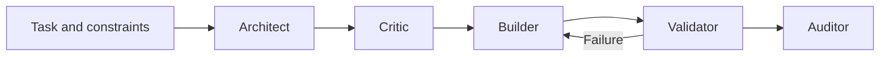

# Technical case study: Codex Master

## Problem
AI coding agents can produce plausible but unverified changes when requirements, role boundaries and acceptance criteria are ambiguous.

## Approach
I developed a documented governance framework separating architecture, critique, implementation, validation and audit responsibilities. Supporting roles cover specialist concerns. The framework requires explicit constraints, repository inspection and evidence-backed completion.

## Architecture

Conceptual role flow, not a deployed orchestration trace.

## Evidence
- [Agent instructions](docs/AGENTS.md)
- [Role contracts](docs/development/modular_agents.md)
- [Acceptance example](docs/development/launch_acceptance.md)
- [Configuration](config.toml)

## Evaluation
The acceptance example separates status, environment, method and evidence. Failed or blocked checks are distinct from passed checks. This is a governance specification, not measured model performance.

## Next steps
Build a reproducible execution harness and evaluate identical tasks with and without the framework using independent acceptance tests.

## Reproducible fixture demonstration

Use the sample acceptance record in `docs/development/launch_acceptance.md`, then run the governance contract checks. The expected result is three passing checks covering truth constraints, repository and testing constraints, and the presence of the reference documents. The demo exercises configuration and documentation. Runtime agent execution is outside this scenario.

```sh
python -m unittest discover -s tests -v
```

## Resume summary
Designed an AI-assisted engineering governance framework with modular agent responsibilities, explicit constraints and evidence-based acceptance criteria.

## Verified CI evidence — 2026-11-25

3 configuration and documentation checks passed; no runtime agent evaluation.

[Completed run](https://github.com/robbiecalvin/codexmaster/actions/runs/45642841023) · [Tested revision](https://github.com/robbiecalvin/codexmaster/commit/7c91c3356784e03d2972316fa32a54c1c762b9f7)
